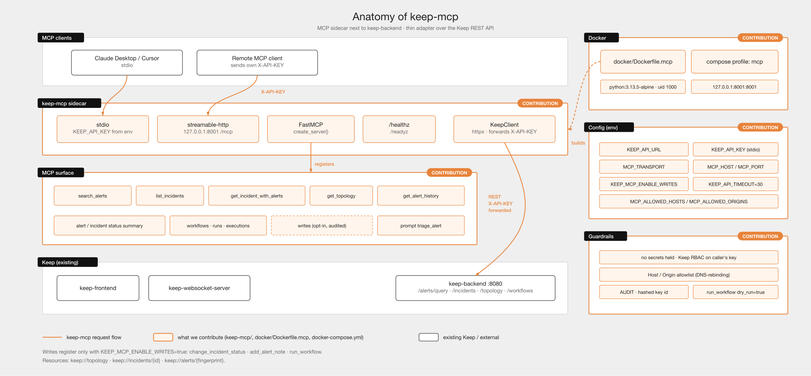

# keep-mcp

MCP server for [Keep](https://github.com/keephq/keep), shipped as a sidecar next to `keep-backend`. It is a thin adapter over the Keep REST API: it holds no secrets or tenancy state and forwards `X-API-KEY`, so Keep remains the single source of truth for authorization.



## Tools

| Tool | Keep endpoint |
|------|---------------|
| `search_alerts(cel, limit, offset)` | `POST /alerts/query` |
| `list_incidents(status, limit, offset)` | `GET /incidents` |
| `get_incident_with_alerts(incident_id)` | `GET /incidents/{id}` + `/incidents/{id}/alerts` |
| `get_topology(services, environment, provider_ids)` | `GET /topology` |
| `get_alert_history(fingerprint)` | `GET /alerts/{fingerprint}/history` |
| `get_alert_status_summary()` / `get_incident_status_summary()` | counts per status via `/alerts/query` and `/incidents` |
| `list_workflows`, `get_workflow(id)`, `list_workflow_runs(id, status)`, `get_workflow_run(id, execution_id)`, `get_alert_workflow_executions()` | `/workflows/...` |

**Write tools** (off by default; set `KEEP_MCP_ENABLE_WRITES=true`): `change_incident_status`, `add_alert_note`, `run_workflow` (`dry_run=true` by default). Each write is audit-logged (hashed key id) and still subject to Keep RBAC for the caller's key.

Prompt: `triage_alert(fingerprint)` – guided triage workflow over the tools above.

Resources: `keep://topology`, `keep://incidents/{id}`, `keep://alerts/{fingerprint}`.
HTTP transport also serves `/healthz` and `/readyz` (the latter checks the backend).

Note: `search_alerts` and `get_alert_status_summary` (6 queries) use Keep's `POST /alerts/query`, which also triggers Keep's background provider pull as a side effect.

## Configuration

| Env var | Default | Description |
|---------|---------|-------------|
| `KEEP_API_URL` | `http://localhost:8080` | keep-backend URL |
| `KEEP_API_KEY` | – | API key for **stdio** only. With HTTP transport, every client must send its own `X-API-KEY` (no env fallback) |
| `MCP_ALLOWED_HOSTS` / `MCP_ALLOWED_ORIGINS` | loopback / none | Comma-separated Host/Origin allowlists (DNS-rebinding protection); add your public hostname when exposing remotely |
| `KEEP_MCP_ENABLE_WRITES` | `false` | Register mutating tools |
| `MCP_TRANSPORT` | `stdio` | `stdio` or `streamable-http` |
| `MCP_HOST` / `MCP_PORT` | `127.0.0.1` / `8001` | HTTP bind address |
| `KEEP_API_TIMEOUT` | `30` | Backend request timeout (s) |

## Run

```bash
cd keep-mcp && pip install -e ".[dev]"
KEEP_API_URL=http://localhost:8080 KEEP_API_KEY=... keep-mcp          # stdio
MCP_TRANSPORT=streamable-http keep-mcp                                 # http://127.0.0.1:8001/mcp
pytest
```

Remote exposure: the MCP server requires a client `X-API-KEY`, but if `keep-backend` runs with `AUTH_TYPE=NO_AUTH` that key is not validated. Only expose the sidecar beyond loopback when the backend enforces authentication.

Docker: `docker compose --profile mcp up keep-mcp` (endpoint `http://localhost:8001/mcp`, published on loopback only; send `X-API-KEY`).

Claude Desktop / Cursor (stdio):

```json
{
  "mcpServers": {
    "keep": {
      "command": "keep-mcp",
      "env": { "KEEP_API_URL": "http://localhost:8080", "KEEP_API_KEY": "<key>" }
    }
  }
}
```
